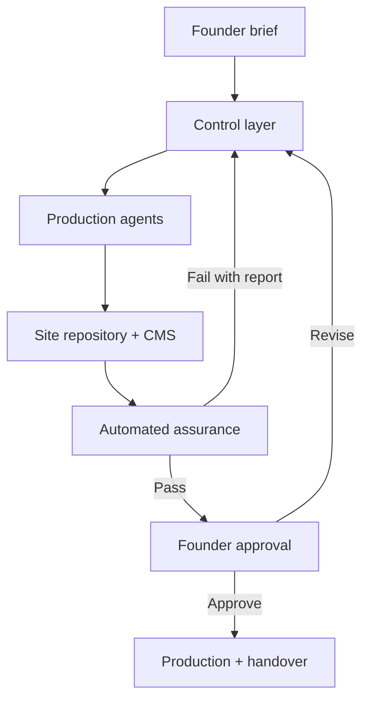

# Web Production Engine — End-to-End Plan

**Audience:** Founder and AI implementation agents  
**Status:** Proposed implementation plan  
**Primary outcome:** The founder submits a structured business brief and receives a reviewed, live, high-quality marketing website whose normal content can be edited through a CMS.

## 1. Executive decision

Build the first version as a **repo-based production system**, not as a fully autonomous SaaS product.

The founder's experience should be simple: complete a guided brief, answer only material questions, approve the strategy and visual direction, review a live preview, and approve launch. Behind that experience, the engine should use a visible sequence of small agents, deterministic generators, approval gates, and automated tests.

The existing concept has the correct high-level journey but is missing the contracts that make the journey reliable. In particular, it does not yet define:

- a machine-readable brief;
- the exact artifact each stage must produce;
- a durable run state so work can stop and resume safely;
- a canonical content model that generates the CMS and site together;
- a controlled design system and section library;
- image sourcing, rights, and optimization rules;
- forms, analytics, privacy, SEO, and security behavior;
- quality gates with measurable pass/fail rules;
- revision, rollback, deployment, and handover procedures;
- a definition of “done” that includes a real CMS edit.

The engine should therefore be built around one principle:

> AI proposes and implements; schemas, generators, tests, and human approvals control the outcome.

## 2. What version 1 will and will not do

### Version 1 target

Version 1 should reliably produce brochure-style websites for Indonesian SMBs:

- 4–10 mostly static pages;
- Indonesian as the default language, with optional English;
- reusable page types such as home, about, service detail, portfolio/case study, article, contact, and legal pages;
- a CMS for global company information and repeatable content collections;
- contact or lead forms;
- SEO basics, analytics, responsive behavior, accessibility, security, and fast page loads;
- preview, production deployment, revision, rollback, and client handover.

### Explicitly outside version 1

- e-commerce, payment processing, memberships, and complex web applications;
- a free-form drag-and-drop page builder;
- support for multiple frameworks, hosts, or CMS products;
- fully automatic publication without founder approval;
- unrestricted AI-generated layouts and components;
- automated conversion optimization without sufficient traffic and an experiment design;
- a polished customer-facing dashboard before the pipeline works from end to end.

These exclusions are important. Breadth would hide pipeline failures and delay a working system.

## 3. Recommended technical foundation

Use a static-first stack and pin all production dependencies to tested versions.

| Area | Choice for version 1 | Why |
| --- | --- | --- |
| Site framework | Astro with TypeScript | Marketing pages ship little JavaScript by default, while interactive components remain possible. |
| Styling | Tailwind CSS plus a small token system | Fast composition with controlled colors, type, spacing, and states. |
| UI components | shadcn/ui where appropriate, wrapped in engine-owned components | Provides accessible foundations without allowing every project to become visually identical. |
| Section patterns | A curated, versioned internal block library inspired by shadcn blocks | Agents choose from proven structures, then customize within limits. |
| Content source | Markdown/MDX, YAML, or JSON stored in the client site repository | Portable, reviewable, and compatible with Git-based workflows. |
| CMS | Pages CMS configured by generated `.pages.yml` | Editors change repository content through a friendlier interface. |
| Hosting | Cloudflare Pages for static sites | Preview deployments, global delivery, and a low operating cost. |
| Dynamic needs | Cloudflare Pages Functions/Workers only when required | Keeps the default site simple and fast. |
| Source control | GitHub; one engine repo and one repo per client site | Separates the factory from its outputs and gives every change a history. |
| CI | GitHub Actions | Runs validation for pull requests and production branches. |
| Browser tests | Playwright, axe-core, Lighthouse CI, link checking, and visual screenshots | Covers behavior, accessibility, performance, links, and appearance. |
| Analytics | Cloudflare Web Analytics by default; another provider only by an explicit decision | A low-complexity default with an optional escape hatch. |

Reference documentation for implementation agents: [Astro content collections](https://docs.astro.build/en/guides/content-collections/), [Astro deployment to Cloudflare](https://docs.astro.build/en/guides/deploy/cloudflare/), [shadcn/ui for Astro](https://ui.shadcn.com/docs/installation/astro), [Pages CMS configuration](https://pagescms.org/docs/configuration/), and [Cloudflare Pages](https://developers.cloudflare.com/pages/).

### Important CMS clarification

Pages CMS is Git-based. The engine does not provision a traditional CMS database. It must instead:

1. create the editable content files and media directories;
2. generate `.pages.yml` with the correct collections and fields;
3. ensure the site reads those files through matching schemas;
4. give the editor appropriate GitHub repository access;
5. verify that a CMS edit creates a repository change and a successful deployment.

If client-owned CMS logins independent from GitHub become a hard requirement, Pages CMS must be re-evaluated before version 2. Do not disguise this product constraint as an implementation detail.

## 4. System architecture

Separate the system into three layers.

1. **Control layer:** receives the brief, records decisions, moves the run between states, requests approvals, and reports failures.
2. **Production layer:** specialized agents produce strategy, content, design direction, assets, code, and deployment configuration.
3. **Assurance layer:** deterministic generators and tests reject invalid, inconsistent, inaccessible, slow, or incomplete output.



### Two repositories, not one

- **Engine repository:** orchestration, schemas, prompts/skills, generators, block library, tests, documentation, and sample projects.
- **Client site repository:** generated site code, content, assets, CMS configuration, deployment configuration, and project decisions.

Never put multiple client sites inside the engine repo. That creates permission, deployment, and handover problems.

## 5. The canonical project contract

Every site must carry a small set of structured files. These are the handoff contracts between agents and make a run auditable and resumable.

```text
project/
  brief.yaml
  assumptions.yaml
  strategy.md
  sitemap.yaml
  page-goals.yaml
  claims.yaml
  content-model.yaml
  design-direction.yaml
  asset-manifest.yaml
  build-plan.yaml
  decisions.md
  run.json
  qa-report.md
  handover.md
```

| Artifact | Purpose | Approval or validation |
| --- | --- | --- |
| `brief.yaml` | Company, audience, offers, evidence, contact data, competitors, preferences, constraints | Schema validation; founder confirms missing critical facts |
| `assumptions.yaml` | Separates facts, founder choices, and AI assumptions | Founder sees any high-risk assumption |
| `strategy.md` | Positioning, conversion approach, message hierarchy, objections, and CTA strategy | Founder strategy approval |
| `sitemap.yaml` | Page hierarchy, routes, navigation, and page types | No duplicate routes or orphaned important pages |
| `page-goals.yaml` | One audience, primary action, supporting action, and proof requirement per page | Every page has a clear job |
| `claims.yaml` | Marketing claims and the evidence supplied for each | Unsupported claims are blocked or marked for approval |
| `content-model.yaml` | The single source of truth for editable content types and fields | Generates site schema and CMS config; drift check must pass |
| `design-direction.yaml` | Tokens, typography, visual mood, references, and chosen section patterns | Founder visual-direction approval |
| `asset-manifest.yaml` | Asset purpose, source, rights, alt text, crop, dimensions, and generation prompt | Missing rights or alt text blocks launch |
| `build-plan.yaml` | Features, routes, components, integrations, and nonstandard decisions | Technical validation before coding |
| `run.json` | Run ID, state, artifact versions, approvals, failures, and resumable next action | Written only by orchestrator |
| `qa-report.md` | All automated results, manual exceptions, screenshots, and known limitations | Preview cannot be approved while blocking checks fail |
| `handover.md` | Ownership, access, editing, deployment, analytics, recovery, and support | Founder confirms access before closure |

Every agent must declare which artifacts it reads and writes. It must not silently change an approved upstream decision; it opens a change request instead.

## 6. End-to-end production workflow

### Stage 0 — Start and classify

The founder selects a supported site type and creates a project. The system creates a run ID, client repository, project files, and a standard issue/checklist.

The classifier must reject or escalate work outside version 1, such as online checkout, authenticated areas, regulated data, or complex integrations.

**Output:** repository, `run.json`, blank structured brief.  
**Gate:** requested project fits the supported scope.

### Stage 1 — Guided brief and evidence collection

Use a guided form or conversational wizard, but save the result as `brief.yaml`. Required sections are:

- business identity and location;
- main audience and the problem they are trying to solve;
- offer, differentiators, price presentation, and desired customer action;
- services or products and their relationships;
- proof: testimonials, credentials, portfolio, results, awards, or guarantees;
- accurate contact, opening hours, social profiles, and map details;
- existing brand assets and visual preferences;
- competitor and inspiration links, with what the founder likes or dislikes;
- legal, privacy, language, accessibility, and deadline constraints;
- content ownership and who will edit which fields after launch.

The intake agent checks completeness and asks a maximum of five prioritized questions at a time. It must never invent addresses, statistics, customer quotes, certifications, prices, or guarantees.

**Output:** `brief.yaml`, `assumptions.yaml`, uploaded source assets.  
**Gate:** all launch-critical facts are supplied or explicitly marked as pending.

### Stage 2 — Strategy, information architecture, and conversion plan

The strategy agent converts the brief into:

- positioning and message hierarchy;
- audience intent and likely objections;
- primary and secondary calls to action;
- page list and navigation;
- page-level goals and proof requirements;
- analytics event plan;
- proposed content collections.

Conversion quality should be judged by clarity, relevance, trust, and friction—not by aggressive language or unsupported promises. A generated website cannot truthfully be called “high converting” until real traffic is measured. The engine can produce a strong conversion hypothesis and make it measurable.

**Output:** `strategy.md`, `sitemap.yaml`, `page-goals.yaml`, first `claims.yaml`.  
**Founder Gate 1:** approve strategy and site structure, or request targeted changes.

### Stage 3 — Content model and CMS plan

This stage occurs before page coding.

The content-model agent identifies:

- **global settings:** business name, logo, contact details, social links, default SEO, and announcement;
- **single documents:** home, about, contact, privacy, and other unique pages;
- **collections:** services, team, testimonials, projects, FAQs, articles, locations, and navigation when appropriate;
- **field rules:** type, required/optional, limits, default, help text, relation, media behavior, and editor visibility;
- **ownership:** client-editable, founder-only, or engine-managed;
- **validation:** slug uniqueness, image requirements, date format, link format, and claim restrictions.

Do not make every layout detail editable. Clients should edit meaningful content without being able to accidentally destroy layout quality.

**Output:** approved `content-model.yaml`.  
**Automated gate:** schema is internally consistent and can be converted to both site and CMS formats.

### Stage 4 — Copy, assets, and design direction

Run three coordinated agents against the approved strategy and content model.

**Copy agent**

- writes content directly into the final content-file structure;
- maps every major claim to `claims.yaml`;
- uses natural Indonesian and the agreed brand voice;
- follows page goals and avoids repeated generic claims;
- produces metadata, labels, validation/error copy, and form confirmation text.

**Asset agent**

- inventories supplied assets before proposing new ones;
- records source and usage rights;
- creates prompts only for assets that may be generated;
- defines focal point, crop, width, format, and meaningful alt text;
- rejects fake documentary images or fabricated customer/team imagery.

**Design-direction agent**

- proposes two or three sufficiently distinct directions using type, color, imagery, density, shape, motion, and proof presentation;
- selects tested section patterns from the block library;
- records deviations and new component needs;
- produces a representative home-page concept at desktop and mobile widths.

**Output:** seeded content, `asset-manifest.yaml`, `design-direction.yaml`, visual concept.  
**Founder Gate 2:** approve one direction and the representative content. This approval locks the tokens and major page pattern.

### Stage 5 — Deterministic generation

The generator—not an AI agent—creates predictable structural output:

- Astro project from a pinned blueprint;
- routes and content folders from `sitemap.yaml`;
- content schemas from `content-model.yaml`;
- `.pages.yml` from the same `content-model.yaml`;
- base components, tokens, navigation, footer, SEO, sitemap, robots file, analytics wrapper, image pipeline, and error pages;
- GitHub Actions and Cloudflare deployment files;
- environment-variable template without secret values;
- initial tests and CMS contract checks.

Generation must be idempotent: running it twice with unchanged input yields no diff. It must protect hand-edited areas or clearly mark generated files.

**Output:** buildable client repository skeleton.  
**Gate:** clean install, schema validation, production build, and “no unexplained diff on second generation” all pass.

### Stage 6 — Implementation

The implementation agent fills approved structures with components and content. It may create a new block only when the existing library cannot satisfy an approved design direction. New blocks require:

- documented purpose and permitted content shape;
- responsive behavior;
- keyboard and screen-reader behavior;
- light/dark behavior only if the project uses both;
- screenshot examples;
- unit or browser coverage where behavior exists.

The agent should use client-side JavaScript only for genuine interaction. Forms, carousels, menus, tabs, maps, video, and animation require explicit performance and accessibility checks.

**Output:** complete local site and pull request.  
**Gate:** code review plus all nonvisual automated tests.

### Stage 7 — Preview, QA, and revision

Every pull request receives a preview URL and one consolidated quality report. Test at minimum:

- desktop widths: 1440 and 1024;
- mobile widths: 390 and 360;
- current Chromium plus one WebKit check for critical flows;
- keyboard navigation and visible focus;
- form success and failure behavior;
- missing content, long content, and missing image fallbacks;
- every internal link and declared external link;
- metadata, canonical URLs, social previews, sitemap, robots, and structured data;
- visual screenshots against the approved direction;
- CMS configuration and content-schema parity;
- a test content edit followed by a successful build.

Founder review is structured around four questions: Is the message accurate? Is the hierarchy clear? Does it look appropriate for the brand? Is any necessary client-editable content missing from the CMS?

Feedback is converted to bounded issues with acceptance criteria. The system distinguishes a correction from a changed approved decision; the latter updates upstream artifacts and records the decision.

**Output:** preview URL and `qa-report.md`.  
**Founder Gate 3:** approve the preview for production.

### Stage 8 — Launch and handover

The release agent checks domain configuration, HTTPS, redirects, analytics, form delivery, privacy links, backup/rollback, repository ownership, Cloudflare access, and editor access. Production deploys only from the protected production branch or an approved release tag.

Handover includes:

- live URL and status;
- repository and hosting ownership;
- CMS login/access explanation;
- a five-minute content-editing guide;
- which content is safe to edit;
- deploy and rollback explanation;
- analytics access and event definitions;
- renewal or ongoing-cost list;
- known limitations and support boundary;
- recovery contact and export instructions.

**Output:** production release, `handover.md`, credentials/access checklist.  
**Founder Gate 4:** confirm access and close the run.

### Stage 9 — Measure and learn

At 7 and 30 days, collect only actionable signals: availability, real-world performance where traffic permits, form delivery, broken URLs, top landing pages, CTA events, and client editing problems. Feed reusable lessons into engine components and rules, never into a client site without review.

## 7. Automatic CMS creation design

This is the most important missing subsystem.

### Single source of truth

`content-model.yaml` should be a small engine-owned format. Each field needs a stable ID and may define:

```yaml
collections:
  services:
    path: src/content/services
    format: md
    route: /services/{slug}
    fields:
      - id: title
        type: string
        required: true
        max_length: 80
      - id: summary
        type: text
        required: true
        max_length: 180
      - id: hero_image
        type: image
        required: true
      - id: body
        type: rich_text
        required: true
```

The exact engine format may change, but it must generate all of the following:

- CMS collections and fields in `.pages.yml`;
- Astro/content validation schemas;
- starter content files;
- route/static-path logic;
- TypeScript types where useful;
- editor documentation;
- test fixtures and invalid-content tests.

### Drift prevention

CI regenerates CMS and site schemas and fails if committed output differs. No agent manually edits generated CMS configuration. A field addition is made once in `content-model.yaml`, then regenerated.

### CMS acceptance test

A site is not complete merely because `.pages.yml` exists. The test scenario is:

1. editor can see every intended collection and no engine-only field;
2. editor changes the business phone number;
3. editor creates a service with image, slug, summary, and body;
4. the change appears as a Git commit;
5. CI validates and deploys it;
6. the global phone number and new service page render correctly;
7. deleting or invalidating required content fails safely with a useful message;
8. rollback restores the prior site.

The first pilot may include a short manual CMS login step because access provisioning depends on account ownership. Everything after access should be repeatable.

## 8. Agent roles and operating rules

| Agent | Reads | Writes | Must not do |
| --- | --- | --- | --- |
| Orchestrator | `run.json`, all gate results | state, task assignments, failure reports | invent business or design decisions |
| Intake | founder answers, source documents | brief and assumptions | invent missing facts |
| Strategist | approved brief | strategy, sitemap, page goals | write final code |
| Content modeler | strategy, sitemap, edit ownership | content model | expose layout internals unnecessarily |
| Copywriter | evidence, strategy, model | content and claims | create unsupported proof |
| Art director | brand inputs, strategy, asset inventory | design direction | use arbitrary untested components |
| Asset producer | manifest and approved prompts | optimized assets and metadata | use unlicensed or deceptive assets |
| Planner | approved artifacts | build plan and tasks | change approved strategy silently |
| Implementer | build plan and blueprint | code and tests | bypass generated contracts |
| QA agent | preview, artifacts, requirements | QA report and issues | waive blocking failures |
| Release agent | approvals and passing report | deployment and handover | deploy without approval |

Operating rules for all agents:

- use the smallest required input set;
- return structured output that validates against a schema;
- identify uncertainty rather than hiding it;
- make no external write, publish, purchase, domain, or access change without the correct gate;
- attach evidence to every completion claim;
- stop after a bounded retry count and report the actual blocker;
- never place secrets in prompts, content files, commits, or reports;
- record the prompt/skill version and input artifact hashes for reproducibility.

## 9. Quality standard and launch gates

### Design quality

- coherent type scale, spacing scale, colors, radii, shadows, icon treatment, and interaction states;
- no arbitrary one-off values unless the design direction records them;
- recognizable hierarchy at a five-second glance;
- mobile composition is designed, not merely stacked desktop content;
- consistent image treatment and crops;
- no placeholder copy, broken assets, template branding, or duplicated IDs;
- screenshots reviewed for every route at desktop and mobile sizes.

### Content and conversion

- one primary action per page;
- value proposition visible without needless scrolling;
- proof placed near important claims and decisions;
- common objections answered before the primary conversion point;
- forms request only necessary information;
- analytics events cover primary and secondary actions;
- all factual claims are traceable to founder-supplied evidence or explicitly approved wording;
- no guarantee of conversion performance before measurement.

### Performance

Use both lab tests and field metrics. Initial lab budgets for representative pages:

- Lighthouse Performance, Accessibility, Best Practices, and SEO: 95 or higher, with a documented exception process;
- no unexpected layout shift; CLS target at or below 0.1;
- LCP target at or below 2.5 seconds on a representative mobile profile;
- INP target at or below 200 ms when real-user data becomes available;
- responsive images with explicit dimensions and modern formats;
- no third-party script without an owner, purpose, and measured cost;
- project-specific JavaScript and image budgets recorded in `build-plan.yaml`.

Lab scores are gates for regressions, not promises about every user's connection. Field performance should be reviewed after launch.

### Accessibility

- WCAG 2.2 AA as the practical target;
- semantic headings and landmarks;
- full keyboard operation and visible focus;
- form labels, instructions, and error summaries;
- sufficient color contrast;
- appropriate alt text or deliberate empty alt text for decorative images;
- reduced-motion support;
- automated axe checks plus manual keyboard and screen-reader spot checks.

### SEO and local discovery

- unique titles and descriptions;
- canonical URLs, sitemap, robots, redirects, and social preview metadata;
- appropriate organization/local-business, breadcrumb, service, or article structured data using verified facts;
- correct language and locale metadata;
- stable, readable URLs;
- search console ownership instructions at handover;
- no mass-generated thin pages.

### Security, privacy, and reliability

- least-privilege GitHub and Cloudflare access;
- secrets stored only in approved secret managers;
- dependency and secret scanning in CI;
- security headers and a practical content security policy;
- form spam protection, rate limits, server-side validation, and safe error messages;
- privacy notice matches actual data collection;
- backups are simply reproducible repository versions plus deployment rollback;
- uptime and form-delivery checks after launch.

### Blocking launch rules

Launch is blocked by broken critical flows, missing legal/privacy content when required, unsupported claims, inaccessible primary navigation or form, unverified form delivery, missing ownership/access, CMS schema drift, failing production build, serious security findings, or absent rollback instructions.

## 10. Proposed engine repository structure

```text
web-production-engine/
  README.md
  docs/
    product-scope.md
    operating-model.md
    founder-guide.md
    architecture-decisions/
  engine/
    cli/
    orchestrator/
    schemas/
    generators/
    validators/
    reporters/
  agents/
    intake/
    strategy/
    content-model/
    copy/
    design/
    implementation/
    qa/
    release/
  blueprints/
    astro-marketing/
  blocks/
    registry.yaml
    sections/
  fixtures/
    valid-briefs/
    invalid-briefs/
    golden-sites/
  tests/
    unit/
    contracts/
    integration/
    end-to-end/
  .github/workflows/
```

Suggested internal commands:

- `wpe init` — create a run and site repo from a brief;
- `wpe validate` — validate all project artifacts;
- `wpe generate` — create deterministic site/CMS structure;
- `wpe build` — run site build;
- `wpe preview` — create or report the preview URL;
- `wpe qa` — run the assurance suite and produce one report;
- `wpe release` — deploy an approved revision;
- `wpe status` — show the current state, blockers, and next founder decision;
- `wpe handover` — produce and verify the handover package.

The founder does not need to operate these commands directly. They are a stable interface for AI agents and a future dashboard.

## 11. Implementation roadmap

Build the vertical path first. Each phase ends with a demonstrable result.

### Phase 0 — Freeze decisions and create the test brief

**Goal:** establish an exact version 1 boundary and a realistic golden project.

Tasks:

1. Write product scope and architecture decision records for Astro, Pages CMS, Cloudflare Pages, GitHub, and one-repo-per-client.
2. Define the supported page types, collections, integrations, and exclusion rules.
3. Create one detailed fictional Indonesian SMB brief with services, testimonials, team, articles, location, bilingual constraint, and a lead form.
4. Define measurable acceptance criteria from section 13.

**Exit:** founder approves the scope; every later phase tests against the same golden project.

### Phase 1 — Contracts, state machine, and deterministic generator

**Goal:** a valid brief generates a buildable but visually basic site with a CMS.

Tasks:

1. Define JSON/YAML schemas for every project artifact.
2. Implement run states, transitions, approval records, retries, and resume behavior.
3. Build the Astro blueprint.
4. Implement `content-model.yaml` to Astro schema, starter content, and `.pages.yml` generators.
5. Add idempotency and schema-drift tests.
6. Add CI install, lint, type, content, and production-build checks.

**Exit:** the golden brief creates valid routes, content, `.pages.yml`, and a successful production build without manual structural coding.

### Phase 2 — Strategy, content, and controlled design

**Goal:** agents turn a brief into approved, usable content and a coherent design direction.

Tasks:

1. Implement intake validation and prioritized follow-up questions.
2. Implement strategy, sitemap, page-goal, claim, and content-model agents.
3. Build the first 12–20 quality-reviewed section patterns covering common needs.
4. Define tokens, design-direction schema, and responsive rules.
5. Implement copy and asset manifests, including claim/evidence and asset-rights checks.
6. Generate home and one repeatable detail page from approved outputs.

**Exit:** the founder can approve strategy and design using previewable artifacts; all copy resides in final content structures.

### Phase 3 — Full implementation and preview deployment

**Goal:** produce a complete, previewable site from the golden brief.

Tasks:

1. Complete all supported page types and navigation states.
2. Implement forms, spam protection, delivery test, and success/failure states.
3. Implement responsive images, fonts, analytics, SEO, redirects, and structured data.
4. Configure preview deployments and production branch rules.
5. Produce automatic route screenshots and a consolidated QA report.

**Exit:** one command or orchestrated action produces a live preview with all golden-project routes.

### Phase 4 — Assurance, CMS round trip, launch, and handover

**Goal:** prove the generated site is operable after generation.

Tasks:

1. Add browser, accessibility, performance, link, metadata, schema, and visual tests.
2. Execute the CMS acceptance test described above.
3. Implement revision classification, rollback, release, and handover steps.
4. Create founder-facing status and decision summaries.
5. Run a failure-recovery exercise at three stages.

**Exit:** a founder can edit content through the CMS, observe a successful redeploy, roll it back, and hand the project to a client.

### Phase 5 — Second pilot and then product interface

**Goal:** prove the engine is general, then reduce founder effort.

Tasks:

1. Run a second, materially different SMB brief without changing engine code for that client.
2. Record every manual intervention and classify it as a missing feature, quality judgment, or unsupported scope.
3. Fix repeated interventions in the engine or block library.
4. Only then build a founder dashboard/wizard over the stable engine commands and artifacts.

**Exit:** two different sites pass the same acceptance suite; the second requires no undocumented structural workaround.

## 12. Work breakdown for AI implementation agents

Create one issue per bounded deliverable. The first backlog should be:

1. Product scope and exclusions.
2. Golden pilot brief and expected outputs.
3. Artifact schemas and validation library.
4. Run-state machine and approval model.
5. Astro blueprint with tokens and base layouts.
6. Content-model format.
7. Astro content-schema generator.
8. Pages CMS `.pages.yml` generator.
9. Starter-content and route generator.
10. Idempotency and drift test suite.
11. Intake agent contract.
12. Strategy and sitemap agent contracts.
13. Claim/evidence ledger and validator.
14. Design-direction format and first section registry.
15. Copy and asset-manifest contracts.
16. Preview deployment workflow.
17. Forms and delivery verification.
18. SEO and analytics defaults.
19. Browser, accessibility, link, and metadata tests.
20. Lighthouse budgets and regression reporting.
21. Visual screenshot matrix and review report.
22. CMS round-trip pilot procedure.
23. Release, rollback, and handover workflow.
24. End-to-end golden test.
25. Second independent pilot.

Each issue must contain: user-visible outcome, allowed files/components, inputs, expected outputs, acceptance tests, prohibited shortcuts, dependencies, and evidence required for completion. An agent should not receive a broad issue such as “build the engine.”

## 13. End-to-end acceptance test

Version 1 is complete only when all of the following are demonstrated on a clean environment:

1. Founder starts with a new supported brief; the system identifies missing critical information.
2. After answers, the system produces strategy, sitemap, page goals, claims, content model, and two or three design directions.
3. Founder approvals are recorded and cannot be silently bypassed.
4. The system creates a separate client repository and a complete site without manual structural coding.
5. The site includes at least six pages, a service collection, article collection, global company settings, navigation, contact form, and legal page.
6. Pages CMS exposes the intended fields and hides engine-owned layout internals.
7. A CMS change to global data and a newly created collection item result in a passing build and updated preview/production site.
8. The preview passes the blocking content, build, accessibility, responsive, link, SEO, security, and performance rules.
9. Founder feedback becomes traceable changes without losing approved content.
10. Production deployment requires approval and can be rolled back.
11. Handover proves that the client/founder owns or can access the repo, hosting, CMS path, analytics, form destination, domain, and recovery instructions.
12. A deliberately interrupted run resumes from its last valid artifact rather than restarting.
13. A second different brief succeeds without editing engine source for that customer.

## 14. Metrics for the engine itself

Track system quality, not the amount of AI activity.

| Metric | Initial target |
| --- | --- |
| Supported briefs reaching a valid preview | At least 90% across pilot fixtures |
| Structural manual interventions | Zero for standard page and collection types |
| CMS round-trip success | 100% for pilot sites |
| Runs resumable after a simulated failure | 100% at tested state boundaries |
| Blocking QA defects at founder preview | Zero |
| Unsupported/fabricated claims | Zero |
| Founder decision points | Four or fewer after brief completion |
| Unexplained generated diff on rerun | Zero |
| Second-site engine-code customization | Zero |

Do not optimize “time to first generated page” at the expense of a CMS, reviewability, or handover. A fast demo is not the product.

## 15. Main risks and controls

| Risk | Control |
| --- | --- |
| AI produces inconsistent design | Curated section registry, locked tokens, representative approval, screenshot review |
| Generic or exaggerated copy | Page goals, claim/evidence ledger, founder approval, prohibited-claim checks |
| CMS exists but cannot operate the site | One content model generates both sides; mandatory round-trip test |
| Schema and CMS drift | Generated files plus CI drift check |
| Founder is overwhelmed by technical details | Decision summaries in business language, limited gates, one consolidated QA report |
| Site becomes slow through images and third parties | Asset manifest, image budgets, script register, Lighthouse regression gate |
| Client breaks layout through CMS | Expose business content, not unrestricted layout controls |
| Credentials leak to agents or repos | Least privilege, secret stores, secret scanning, no secrets in artifacts |
| Pages CMS access model does not fit the client | Confirm editor/account requirements during intake; documented alternative decision before build |
| One successful demo is hard-coded | Golden fixture plus a materially different second pilot |
| Agent failure loses progress | Durable state machine, artifact hashes, bounded retries, resume tests |

## 16. Founder decisions required before implementation

Only five decisions are needed to start:

1. Confirm that version 1 serves brochure-style SMB sites, not stores or web applications.
2. Confirm Astro + Pages CMS + Cloudflare Pages + GitHub as the single supported stack for the first two pilots.
3. Confirm that client editors may need GitHub-backed access for Pages CMS.
4. Choose the first golden-pilot business and provide enough truthful source material.
5. Approve four human gates: strategy, visual direction, preview, and production/handover.

Everything else should be implemented and tested as an engineering backlog, not reopened as a founder decision unless a real constraint appears.

## 17. Immediate next action

Do not begin with the dashboard or more agent prompts. Begin with **Phase 0 and Phase 1**: the golden brief, artifact schemas, state machine, canonical content model, Astro blueprint, `.pages.yml` generator, and end-to-end CMS contract test.

The first meaningful milestone is deliberately plain-looking:

> A validated brief deterministically creates a buildable Astro site, correct editable content, and a working Pages CMS configuration; a content edit rebuilds the site successfully.

Once that works, agentic strategy, copy, design, and visual quality can be layered on without leaving another gap in the foundation.

---

## Source note

This plan expands the project concept in **Web Production Engine.md**, particularly its proposed founder-to-agent-to-live-site workflow and initial stack. Repository inspection through the selected GitHub connection returned no accessible repository record for `yasir-mukhtar/web-production-engine`; therefore, the gap assessment is based on the supplied document rather than unverified implementation code.
